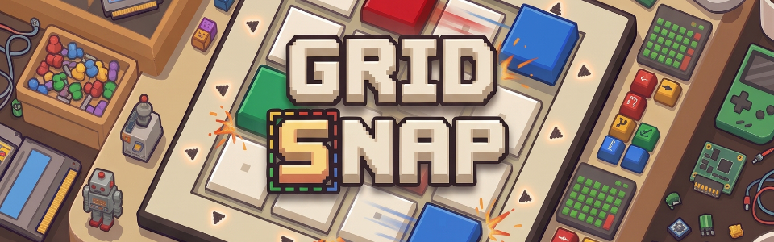

# 🕹️ Grid Snap

> A casual 2D torus puzzle where you shift rows and columns to snap colors into their frames. Built for **GitHub Game Off 2026** (Theme: **SHIFT**).



**Grid Snap** is a tactile, retro-styled mobile and web puzzle game created for the **[GitHub Game Off 2026](https://itch.io/jam/game-off-2026)** game jam. 

The game explores a physical spatial interpretation of the theme **SHIFT**: players cyclically slide continuous rows and columns across a 2D toroidal grid. Tiles that push past one edge wrap around seamlessly to the opposite side. The objective is to shift the matrix until every colored block snaps into its matching fixed target frame before time runs out.

Built with a "no move limits" philosophy, you're never penalized for exploratory shifts or trying out patterns—experiment as much as you like, as long as you beat the stage timer to earn your 3 stars!

---

## 🕹️ How to Play & Rules

* **Cyclic Shifting:** Click, tap, or drag horizontally along any row or vertically along any column. Release to snap it into place.
* **Toroidal Wrap-Around:** Blocks pushed off any edge automatically wrap around to the opposite side of the grid.
* **Snap to Match:** Target wireframes stay anchored on the board; shift matching colored blocks into position to snap and lock them in.
* **No Move Limits:** Slide tiles freely without move-count stress—your only adversary is the ticking clock.
* **3-Star Clear Milestones:** Clear the board before the milestone timer runs down to earn up to 3 stars and coins for boosters.
* **Escrow Heart System:** Starting a stage places 1 heart in escrow. Clear the puzzle to get it back; running out of time forfeits it.
* **Boosters:** Tap **HINT** (highlights the optimal next move) or **+5S** (adds emergency extra time) whenever you're in a pinch.

---

## ✨ Features

* **Chunky & Tactile Pixel-Art Style:** 3D beveled blocks, crisp ink borders, and mechanical button presses that make every slide feel tactile and physical.
* **Handmade & Scalable Levels:** 15 handcrafted campaign stages scaling from fast 3×3 onboarding boards up to dense 4×8 matrices.
* **Standalone Browser Level Editor:** Run `npm run dev:editor` to launch a dedicated WYSIWYG level authoring tool with automated unsolve algorithms, par calculations, and live playtesting.
* **Live Remote Balancing:** Level curves, difficulty tuning, and the coin economy can be updated on the fly via remote config without needing a new build.
* **Smart In-Browser Hint Solver:** An in-browser optimal solver calculates the shortest solution path when you request a hint, projecting a pulsating visual guide on the board.
* **Colorblind Accessibility:** Toggle Colorblind Mode in Settings to overlay distinct geometric shape symbols (Circle, Triangle, Square, Diamond, Star, Cross) on all blocks and target frames.
* **Zero-Download Procedural SFX & Gemini Music:** Retro sound effects synthesized natively in real time via the WebAudio API, paired with continuous background music generated through Gemini.

---

## 🤖 Statement on AI Usage & Prototyping

This project was built as an active experiment in using modern AI tools to explore how they can help non-coding game designers rapidly prototype and test ideas.

I have been designing games professionally for over 16 years, but without a traditional programming background. For years, turning an idea from *"I know what this should feel like"* into *"I can show you what this feels like"* meant months of fighting boilerplate, syntax, and tooling.

Rather than treating AI as a "slot machine" for disposable single-prompt games, I used **Google Antigravity**, **Gemini** (for code assistance, concept art, and background music generation), and **Google Stitch** (for UI layouts) as collaborative design and execution partners. The AI handled the technical scaffolding and asset generation, allowing me to focus entirely on the craft of game design: spatial rules, tactile feel, difficulty pacing, and quick playable prototyping.

I document my learnings, practical non-coder workflows, and game design philosophy on my Substack: **[Game Design Bites](https://gamedesignbites.substack.com/)**.

---

## 🛠️ Technical Stack

* **Framework:** [React 19](https://react.dev/) + [TypeScript](https://www.typescriptlang.org/)
* **Build Tool:** [Vite 6](https://vite.dev/)
* **Styling & Layout:** [Tailwind CSS v4](https://tailwindcss.com/) with Container Queries (`cqw` / `cqh`)
* **State Management:** [Zustand](https://github.com/pmndrs/zustand) with `localStorage` persistence
* **Mobile Runtime:** [Capacitor 8](https://capacitorjs.com/) (Web & Android)
* **Audio:** WebAudio API procedural synthesizer for SFX + seamless background music generated through Gemini
* **Testing:** [Vitest](https://vitest.dev/)
* **Typography:** *Press Start 2P*, *Silkscreen*, *Space Mono*, and *Be Vietnam Pro*

---

## 🚀 Getting Started

### Prerequisites
* [Node.js](https://nodejs.org/) (v18 or higher recommended)
* `npm`

### Installation
```bash
git clone https://github.com/ishanmanjrekar/grid-snap.git
cd grid-snap
npm install
```

### Running the Game Dev Server
```bash
npm run dev
```
Open [http://localhost:5173](http://localhost:5173) in your browser.

### Running the Standalone Level Editor
```bash
npm run dev:editor
```
Open [http://localhost:5174](http://localhost:5174) to author, solve, and test custom levels.

### Running Tests
```bash
npm test
```

---

## 📦 Available Scripts

| Command | Description |
| :--- | :--- |
| `npm run dev` | Launch the main game in development mode (port `5173`). |
| `npm run dev:editor` | Launch the standalone Level Editor on an isolated port (`5174`). |
| `npm test` | Run the Vitest unit test suite (toroidal math, FTUE, solver par). |
| `npm run build` | Typecheck with `tsc` and compile production web bundle into `dist/`. |
| `npm run build:itch` | Run the Itch.io packaging script (creates POSIX zip in `dump/`). |
| `npm run build:apk` | Compile and build the Android APK via Capacitor. |
| `npm run preview` | Locally preview the compiled production build. |

---

## 📖 Documentation Index

Complete project specifications and design documents are available in the [`docs/`](./docs/) directory:

* [Game Design Document (`docs/game-design.md`)](./docs/game-design.md) — Master design index, toroidal math rules, and win/loss states.
* [Technical Architecture (`docs/architecture.md`)](./docs/architecture.md) — Zustand store architecture, IDA\* worker, and audio engine.
* [Art Direction & UI System (`docs/art-direction.md`)](./docs/art-direction.md) — Palette tokens, 3D bevels, and colorblind symbols.
* [Economy & Progression (`docs/economy-and-progression.md`)](./docs/economy-and-progression.md) — Heart escrow, coin rewards, and booster tuning.
* [UI/UX & Screen Flows (`docs/ui-ux-and-flows.md`)](./docs/ui-ux-and-flows.md) — Modal flows, drag-and-snap controls, and FTUE tutorial.
* [Level Design & Editor (`docs/level-design.md`)](./docs/level-design.md) — Level authoring pipeline, auto-unsolving, and IDA\* par math.
* [Implementation Progress (`docs/progress.md`)](./docs/progress.md) — Build checklist, verification gates, and maintenance log.

---

## ⚖️ License

The source code in this repository is licensed under the [GNU General Public License v3.0 (GPLv3)](LICENSE).

> [!IMPORTANT]
> The **GPLv3 license applies to the source code, engine, and logic** in this repository. Original game branding, artwork, and audio assets remain subject to their creator's copyright.

---

## ☕ Support & Follow

* **Game Design Blog:** [Subscribe to Game Design Bites on Substack](https://gamedesignbites.substack.com/)
* **Support:** [Buy me a coffee on Ko-fi!](https://ko-fi.com/ishanmanjrekar/tip)
* **Playable Prototypes:** [Check out my other games on itch.io](https://playable-things.itch.io/)

