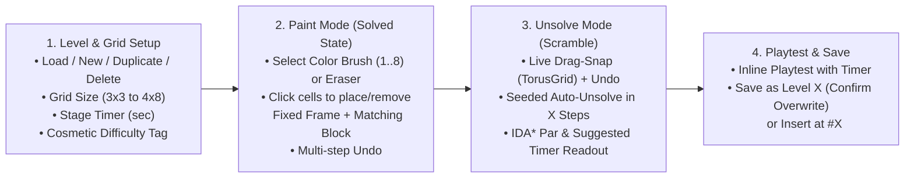

# Level Design & Level Editor Specification

### Related Documents
- [Game Design Document](./game-design.md) - Master index, core gameplay loop, toroidal shifting mechanics, and win/loss conditions.
- [Technical Architecture](./architecture.md) - Zustand state management, 2D toroidal grid engine, IDA\* solver worker, `vite.editor.config.ts`, and `src/config/levels.json` schema.
- [Art Direction & UI System](./art-direction.md) - `Color Shift 16-Bit Arcade` visual theme, 8-color block bevels, colorblind shapes, and dashed target frame tokens.
- [Economy, Boosters & Progression](./economy-and-progression.md) - Heart escrow system, flat 200-coin clear reward, speed-based star ratings, `HINT` & `EXTRA TIME` boosters, and Ko-fi store.
- [UI/UX & Screen Flows](./ui-ux-and-flows.md) - Complete screen inventory, Main Menu level path difficulty badges, drag-only input rules, and `<BoundingBox>` layout rules.
- [Implementation Plan & Progress Harness](./progress.md) - Live 9-phase build checklist, session status tracker, and verification gates.

---

## 1. Level Design Philosophy & Core Principles

### 1.1 Reverse ("Solved-to-Unsolved") Authoring Model
Every puzzle in **Grid Snap** is constructed **backward from its solved state**:
1. The designer selects a **Grid Size** (`3×3` minimum up to `4×8` maximum).
2. The designer places **1 or more colored blocks at their final solved positions**. Placing a block at `(r, c)` automatically anchors a **Fixed Target Frame** of that same color at `(r, c)`. There are **no decoy blocks or decoy frames**—every colored block on the board corresponds 1:1 with a target frame of that color.
3. Once all desired target `(Frame + Block)` pairs are placed, the frames lock into their fixed positions and the blocks are **unsolved** (scrambled) by sliding rows and columns—either manually via drag-and-snap or via **`Auto Unsolve in X Steps`**.

Because the starting board (`initialGrid`) is reached from the solved state (`frames`) exclusively through valid toroidal row/column shifts, **100% of levels are mathematically guaranteed to be solvable**.

---

## 2. Abstract Color Slots & Multi-Block Same-Color Rules

### 2.1 Session-Randomized Color Palette (`0 .. K-1`)
Colors in a level are **not** permanently bound to a single hardcoded hue at runtime:
- **In the Level Editor**: The designer selects colors from the **8-Color Brush Palette** (visually shown as Ruby/Slot 0, Emerald/Slot 1, Cobalt/Slot 2, Yellow/Slot 3, Purple/Slot 4, Cyan/Slot 5, Tangerine/Slot 6, Magenta/Slot 7) so they can clearly see and group colors while designing.
- **When Saved to `src/config/levels.json`**: The editor normalizes the distinct colors used on the board into **Abstract Color Slot Indices (`0, 1, ..., K-1`)** and records `colorCount: K` (where $1 \le K \le 8$). Neutral cells are stored as `null`.
- **When Loaded In-Game**: Whenever a player starts the level, the engine randomly selects `K` distinct colors from the 8-color `BlockColor` palette (`sessionPalette: BlockColor[]`) and maps slot index `i` to `sessionPalette[i]`.
  - **Result**: The spatial puzzle structure and color groupings are identical for every player, while the visual color palette feels fresh on every playthrough.

### 2.2 Multiple Blocks of the Same Color (Interchangeable Solve Equivalence)
A level can contain **multiple blocks and frames of the same color** (for example, placing Ruby at `(0, 1)` and placing Ruby again at `(2, 2)`):
- **Interchangeable Win Condition**: Blocks of the same color are completely interchangeable. A target frame at `(r, c)` with color slot `cIdx` (`frames[r][c] === cIdx`) is **Snapped / Solved** whenever **any** block of color slot `cIdx` occupies `(r, c)` (`grid[r][c] === cIdx`).
  - *Example*: If Ruby Block #2 lands in Ruby Frame #1 and Ruby Block #1 lands in Ruby Frame #2, **both** frames are valid solves!
- **Impact on Unsolving & Solver Par**: Because any block of Color $C$ satisfies *any* frame of Color $C$, manual unsolving indicators, the **Smart `Auto-Unsolve in X Steps`** engine, and the **IDA\* Minimum-Moves Solver** all evaluate states strictly by **color equality (`grid[r][c] === frames[r][c]`)**, never by individual block instance IDs.

---

## 3. Standalone Level Editor (`npm run dev:editor`)

### 3.1 Execution, Code Sharing, Typography & File Persistence Architecture
Matching the clean workflow from `loop-game`, the Level Editor is a standalone internal developer tool:
- **Game Dev Server**: `npm run dev` (runs `vite` on port `5173` using `vite.config.ts`).
- **Level Editor Server**: `npm run dev:editor` (runs `vite --config vite.editor.config.ts` on port `5174` rooted at `editor/index.html`).
- **Isolated Vite Cache for Concurrent Servers**: `vite.editor.config.ts` configures `cacheDir: path.resolve(__dirname, 'node_modules/.vite-editor')` so `npm run dev` (`:5173`) and `npm run dev:editor` (`:5174`) can run concurrently without pre-bundled dependency hash collisions, while `src/index.css` declares `@source "../src";` and `@source "../editor";` so Tailwind CSS v4 scans both source trees regardless of the active Vite root.
- **Shared Core & Desktop Layout**: The editor imports `src/engine/*` (toroidal shift functions, `autoUnsolve`, IDA\* `solveParMoves`) and `src/components/TorusGrid.tsx` directly so board interactions feel identical to the live game, while rendering inside a wide multi-panel desktop layout (not constrained to `<BoundingBox>`).
- **Editor Typography (High-Legibility Authoring)**:
  - **Main Header Title**: Uses `font-pixel` (`'Press Start 2P'`) exclusively on the top `GRID SNAP // LEVEL EDITOR` title (`editor/EditorApp.tsx`).
  - **All Body Text, Labels, Inputs, Dropdowns & Buttons**: Uses **`Be Vietnam Pro`** (`'Be Vietnam Pro', system-ui, -apple-system, sans-serif`, loaded in `editor/index.html`) so dense authoring controls, stats, and level lists remain effortless to read during long design sessions.
- **Direct Disk Read/Write (`saveLevelPlugin` in `vite.editor.config.ts` & `vite.config.ts`)**:
  - `GET /api/levels`: Reads and returns the full levels array from `src/config/levels.json`.
  - `POST /api/save-level`: Inserts a new level or overwrites an existing **Level No. `X`** inside `src/config/levels.json` (sorted by `id: number`) and formats the JSON cleanly on disk.
  - `POST /api/insert-level`: Inserts the level at **Level No. `X`** and shifts all existing levels with `id >= X` up by `+1`.
  - `DELETE /api/level/:id`: Deletes **Level No. `X`** and re-indexes remaining levels sequentially (`1 .. N`).

### 3.2 Level Editor UI & Step-by-Step Workflow

#### Panel 1: Level Selector, CRUD Actions & Metadata Controls
1. **Load Existing Level Dropdown & Management Buttons**:
   - Select any existing level (`Level 1`, `Level 2`, ...) from `src/config/levels.json` to load its grid size, timer, difficulty tag, fixed frames, and unsolved block positions into the editor.
   - **`+ NEW LEVEL`**: Initializes a blank board defaulting to `id = maxLevelId + 1`.
   - **`DUPLICATE`**: Copies the currently loaded level into a new draft with `id = maxLevelId + 1`.
   - **`DELETE LEVEL`**: Deletes the currently loaded level (after confirmation) via `DELETE /api/level/:id` and re-indexes remaining levels.
2. **Target Level Number (`id`)**: Numeric input (`1, 2, 3...`) specifying which **Level No. `X`** this puzzle will be saved or inserted as.
3. **Grid Size Selector**:
   - **Columns (`cols`)**: `3` or `4`
   - **Rows (`rows`)**: `3`, `4`, `5`, `6`, `7`, or `8`
   - *(Supports any matrix from `3×3` min to `4×8` max; resizing preserves existing placements that fit within the new bounds).*
4. **Stage Timer (`timeLimitSeconds`)**: Numeric input in seconds (e.g., `30`, `45`, `60`, `90`), paired with an **`APPLY SUGGESTED TIME`** quick-fill button driven by the IDA\* solver.
5. **Cosmetic Difficulty Tag (`difficulty`)**:
   - **`NORMAL`**: Standard stage — **no difficulty badge** is shown on the Main Menu level path node.
   - **`HARD`**: Displays the Crimson **`HARD`** badge on the Main Menu level path node.
   - **`SUPER HARD`**: Displays the Purple **`SUPER HARD`** badge on the Main Menu level path node.
   - *(Note: All levels award a flat `+200 Coins` on clear; difficulty tags are visual pacing markers on the level path).*

#### Panel 2: Editor Mode Switcher, Undo & Canvas
- **Mode A — `1. PLACE FRAMES & BLOCKS` (Solved State Setup)**:
  - Displays the **8-Color Brush Bar** (`Color 1..8`) + **`ERASER`** + **`UNDO`** + **`CLEAR BOARD`**.
  - Clicking cell `(r, c)` with a color brush places **both** the Fixed Target Frame and the matching Colored Block at `(r, c)`.
  - Selecting the same color brush and clicking additional cells places multiple blocks/frames of that same color.
  - Clicking an already-populated cell with the same color (or with `ERASER`) removes both the frame and block from `(r, c)`, reverting it to a neutral tile.
  - Live summary badge shows: `Colors Used: K | Total Target Blocks: M`.
- **Mode B — `2. UNSOLVE / SCRAMBLE` (Slide Blocks Away from Frames)**:
  - Locks all placed Target Frames in position (`frames[r][c]`) and enables toroidal drag-and-snap sliding on `grid[r][c]` using the shared `<TorusGrid>` component (consistent with the live game, drag-only input; decorative bezel arrows are non-clickable).
  - **`UNDO` Button**: Reverts the last manual drag shift or auto-unsolve operation on the scramble stack.
  - **Auto Unsolve in `X` Steps (Seeded)**:
    - Numeric input for **`X` Steps** (e.g., `X = 4`), optional **Seed (`scrambleSeed`)** input (auto-generated if left blank so scrambles can be reproduced), and **`AUTO UNSOLVE`** button.
    - Automatically resets blocks to their solved frames and executes `X` smart multi-slot line shifts (detailed in Section 4 below) so the board lands in a clean unsolved state.
  - **`RESET TO SOLVED`**: Snaps all blocks back into their matching frames (`grid = clone(frames)`).
  - **Live Solver Par & Unsolve Status Readouts**:
    - **`Matched Frames: k / M`**: Highlights green `0 / M PRE-MATCHED` when `matchedSlots === 0`, or displays an amber non-blocking warning (`k / M FRAMES ALREADY MATCHED — STILL SAVABLE`) if `matchedSlots > 0` while `!isSolved`.
    - **`Solver Par (Min Moves): P Moves`**: Runs the IDA\* solver on the current scrambled board to display the true minimum number of line shifts required to solve the board (since commuting row/column scrambles can sometimes be solved in fewer than `X` moves).
    - **`Suggested Timer: T sec`**: Recommends a balanced `timeLimitSeconds` based on `parMoves` and grid size.
- **Mode C — `3. PLAYTEST` (Inline Verification)**:
  - Runs the level live inside the editor with the configured `timeLimitSeconds` countdown, 3-Star bar, and `HINT` preview so you can verify solve feel before saving.

#### Panel 3: Save & Insert Bar
- **`SAVE AS LEVEL X` Button**:
  - Validates that at least 1 target block is placed and the board is not currently in a solved state (`!isSolved`). Allows saving with a warning if `matchedSlots > 0`.
  - If `Level X` already exists in `src/config/levels.json` (and differs from the originally loaded level ID), prompts for overwrite confirmation before posting to `/api/save-level`.
  - Saves normalized color slots `0 .. K-1`, `parMoves`, and `scrambleSeed`.
- **`INSERT AT LEVEL X (SHIFT +1)` Button**:
  - Inserts the level at `id = X` and shifts existing levels `>= X` up by `+1` via `/api/insert-level`.

---

## 4. Smart `Auto-Unsolve in X Steps` & True Solver Par

### 4.1 Definition of a Single Step (Multi-Slot Line Shift)
In **Grid Snap**, a single **Step** is defined as sliding an entire row `r` or column `c` by **$k$ slots**:
- **Row Step**: `(axis: 'row', index: r, distance: k)` where $r \in [0, \text{rows}-1]$ and $k \in [1, \text{cols}-1]$.
- **Column Step**: `(axis: 'col', index: c, distance: k)` where $c \in [0, \text{cols}-1]$ and $k \in [1, \text{rows}-1]$.

*Note*: On a cyclic torus of length $L$, shifting right/down by $k$ slots ($1 \le k \le L-1$) covers every possible non-zero shift in **both** directions (since shifting left/up by $d$ slots is identical to shifting right/down by $(L - d) \bmod L$ slots!).

### 4.2 The 4 Smart Rules for Valid Unsolve Steps
When executing `autoUnsolve(frames, X, seed)`, the algorithm starts from the solved board (`grid = clone(frames)`) using a seeded PRNG (`mulberry32(seed)`) and searches for a sequence of `X` steps $S_1, S_2, \dots, S_X$ that obeys all four rules:

1. **Rule 1 — No Consecutive Steps on the Same Row or Column**:
   - Step $S_t$ **cannot** operate on the same `(axis, index)` as Step $S_{t-1}$.
   - *Why*: Two consecutive shifts on Row `1` collapse into a single shift of $(k_1 + k_2) \bmod \text{cols}$ on Row `1`, reducing an $X$-step puzzle to $X-1$ or $X-2$ steps.
2. **Rule 2 — Every Step Must Mutate the Board's Color State (`nextGrid !== currentGrid`)**:
   - A candidate step `(axis, index, k)` is rejected if applying it leaves all cell colors along that row or column unchanged (preventing shifts on all-neutral lines, single-color lines, or periodic multi-block patterns shifted by their period).
3. **Rule 3 — No Accidental Intermediate Re-Solve**:
   - For every step $t \in [1, X]$, the resulting board state must satisfy `!isSolved(grid, frames)` and must not revisit an exact board state already seen earlier in the unsolve path.
4. **Rule 4 — Multi-Block Same-Color Disjointness on Step `X` (`matchedSlots === 0`)**:
   - At the completion of Step `X`, the algorithm checks `getSnapProgress(grid, frames)` across **all** frames using color-slot equality (`grid[r][c] === frames[r][c]`).
   - **Target Outcome**: `matchedSlots === 0` — meaning **no** colored block is sitting inside *any* frame of its own color.
   - **Fallback for Ultra-Dense Boards**: Using multi-trial sampling (up to `200` fast in-memory rollouts), `autoUnsolve` picks a valid $X$-step sequence that maximizes solver `parMoves` while achieving `matchedSlots === 0` (or minimizing `matchedSlots` if `0` overlap is impossible by Pigeonhole Principle).

### 4.3 Why Solver Par (`parMoves`) Complements Unsolve Depth (`X`)
Because two non-consecutive shifts on parallel lines commute (for example, `Row 0 +1`, `Row 1 +2`, `Row 0 +1` can be solved in `2` moves by combining the two `Row 0` shifts), `X` is an upper bound on solve depth rather than the exact minimum move count. Running the **IDA\* Solver (`solveParMoves`)** immediately after scrambling gives the designer the exact **`parMoves`** count and powers the in-game **`HINT ($50)`** booster.

---

## 5. End-of-Campaign Loop & Future Procedural Generation

### 5.1 Active Interim Rule: Repeat Last 10 Levels (`L > N`)
Until procedural level generation is enabled, hand-crafted campaign levels are authored manually in the Level Editor and saved to `src/config/levels.json` (`1 .. N`):
- For `1 <= L <= N`, stage `L` loads `levels[L - 1]`.
- Once the player clears level `N`, any subsequent level `L > N` automatically cycles through the **last `min(10, N)` levels** (`levels[(N - loopSize) + ((L - N - 1) % loopSize)]`), while the player's `unlockedLevel` counter and HUD stage number (`LVL. L`) continue incrementing indefinitely.

### 5.2 Future Procedural Level Generation Hook (Post-Campaign — Rules TBD)
> [!NOTE]
> **Deferred Until Hand-Crafted Campaign Is Built & Playtested**
> Once the hand-crafted campaign levels in `src/config/levels.json` are authored and playtested, `getLevelConfig(L)` can switch from the Last-10 Loop to `generateProceduralLevel(L)` using the same `LevelConfig` format, `autoUnsolve(frames, X, seed)` engine, and IDA\* solver.
