# UI/UX Specification & Screen Flows

### Related Documents
- [Game Design Document](./game-design.md) - Master index, core gameplay loop, toroidal shifting mechanics, and win/loss conditions.
- [Technical Architecture](./architecture.md) - Zustand state management, 2D toroidal grid engine, IDA\* solver worker, `AudioManager`, debug mode, and JSON schemas.
- [Art Direction & UI System](./art-direction.md) - `Color Shift 16-Bit Arcade` visual theme, color tokens, 3D tile bevels, colorblind shapes, pixel typography, animation, and audio specs.
- [Economy, Boosters & Progression](./economy-and-progression.md) - Heart escrow system, flat 200-coin clear reward, speed-based star ratings, `HINT` & `EXTRA TIME` boosters, and frictionless Ko-fi store.
- [Level Design & Level Editor](./level-design.md) - Reverse solved-to-unsolved authoring, multi-block same-color rules, standalone Level Editor (`npm run dev:editor`), IDA\* par solver, and last-10 campaign loop.
- [Implementation Plan & Progress Harness](./progress.md) - Live 9-phase build checklist, session status tracker, and verification gates.

---

## 1. Screen Navigation & State Flow

```mermaid
stateDiagram-v2
    [*] --> SplashScreen : App Boot (Loads splash.webp & 0-100% Loader)
    SplashScreen --> MainMenu : Tap to Continue / Space / Enter (Unlocks Audio)
    MainMenu --> ItemStore : Tap STORE / Tap [+] on Coins or Lives
    ItemStore --> MainMenu : Tap ◀ BACK TO MENU
    MainMenu --> SettingsModal : Tap ⚙ Settings
    SettingsModal --> MainMenu : Tap ✕ Close
    MainMenu --> InGame : Tap ▶ PLAY (if Lives >= 1; holds 1 ❤️ in escrow)
    MainMenu --> ItemStore : Tap ▶ PLAY (if Lives == 0)

    state InGame {
        [*] --> TutorialOverlay : First time playing Level 1
        TutorialOverlay --> ActivePlay : Tap to Continue ▼
        [*] --> ActivePlay : Standard Stage Start
        ActivePlay --> PauseModal : Tap ⏸ Pause / App Backgrounded
        PauseModal --> ActivePlay : Tap RESUME
        ActivePlay --> LevelCompleteModal : All Target Frames Matched (refunds 1 ❤️ + 200 Coins)
        ActivePlay --> OutOfTimeModal : Timer reaches 00:00
        OutOfTimeModal --> ActivePlay : Tap +30 SECONDS ($200, if Coins >= 200)
        ActivePlay --> DebugPanel : Double-tap any HUD Star (Dev/APK only)
        DebugPanel --> ActivePlay : Close Debug Panel
    }

    PauseModal --> MainMenu : Tap QUIT (forfeits escrowed 1 ❤️; same level selected)
    LevelCompleteModal --> InGame : Tap NEXT LEVEL ▶ (advances unlockedLevel; holds 1 ❤️)
    LevelCompleteModal --> MainMenu : Tap ✕ Close (unlockedLevel advanced)
    OutOfTimeModal --> MainMenu : Tap ✕ Close (forfeits escrowed 1 ❤️; same level selected)
```

All screens and modals render inside the single root `<BoundingBox width={450} height={800}>` wrapper (`src/components/BoundingBox.tsx`) without page reloads.

---

## 2. Reference Mapping (`ui-refs/` & Assets to React Views & Approved Design Overrides)

Every screen and popup in the game maps to a reference asset or folder in `./ui-refs/`, with the following **locked design overrides** applied during implementation:

| Screen / Modal | Source Reference / Asset | View Type | Key UI Responsibilities & Locked Overrides |
| :--- | :--- | :---: | :--- |
| **Boot Splash Screen** | `itch-assets/splash.png` → `public/splash.webp` | Full-Screen Boot Overlay (`SplashScreen`) | Full-bleed cover artwork (`900×1650` optimized WebP), `0%–100%` loading progress bar (`LOADING CARTRIDGE...` → `CARTRIDGE READY`), and pulsing `TAP TO CONTINUE` prompt (or `Space`/`Enter`) that fades/scales out (`450ms`) and unlocks WebAudio. |
| **Main Menu & Level Path** | `color_shift_retro_main_menu_difficulty_tags` | Full Screen (`menu`) | Top Coin/Heart HUD capsules (**Override**: displays `FULL` with no timer when `lives >= 5`), `STORE` & `⚙` buttons, vertical Level Path (`unlockedLevel` at bottom, no replay of cleared levels, loops last 10 levels past `N`), `STAR COUNT` vanity bar + Share button, and Gold `▶ PLAY` CTA. |
| **In-Game (`3×3`–`4×4`)** | `color_shift_pastel_minimalist_game_ui` | Full Screen (`playing`) | Top Bar (`$` pill, `LVL. X`, `⏸`), `⏳ MM:SS` timer pill, 3-Star progress bar (**Override**: star `left: %` driven by `economy.json`), central arcade bezel (**Override**: `▲▼◄►` arrows are visual-only `pointer-events: none`; input is drag-only), bottom **`💡 HINT ($50)`** (**Override**: replaces `REWIND`) & **`+5S EXTRA TIME ($100)`** units. |
| **In-Game (`4×5`–`4×8`)** | `color_shift_4x8_grid_pixel_art_puzzle_ui` | Full Screen (`playing`) | Same bolted top HUD and bottom powerup footer, with the central `flex-1 min-h-0` stage auto-scaling the taller `4×8` (32-tile) bezel and 8-row decorative side arrows cleanly without scrolling. |
| **Tutorial Intro Overlay** | `color_shift_tutorial_intro_overlay_ui` | Scrim Overlay | Dark scrim (`#2C2523/70`), dark charcoal card (`#2C2523`) with cream border (`#F4EFE0`), overhanging gold `TUTORIAL` badge, instruction text, and blinking `TAP TO CONTINUE ▼` prompt. |
| **Pause Modal** | `color_shift_pause_menu_popup_ui` | Modal Overlay | Dark scrim (`bg-black/60`), overhanging gold `PAUSED` badge, inset `||` icon box, green `RESUME` button, cream `QUIT` button with `YOU WILL LOSE 1 ❤️` warning below. |
| **Level Complete Modal** | `color_shift_level_complete_popup_x_close` | Modal Overlay | Overhanging gold `LEVEL X CLEAR!` banner, top-right red `✕` close button, 3 chunky pixel stars, status pill, inset stats box (`TIME` [**Override**: no `BEST!` badge], `SHIFTS`, `COINS: +200`), green `NEXT LEVEL ▶` CTA. |
| **Out of Time Modal** | `color_shift_out_of_time_popup_x_close` | Modal Overlay | Overhanging crimson `TIME'S UP!` banner, top-right red `✕` close button with `-1 ❤️` badge directly underneath, pixel hourglass box, `! YOU RAN OUT OF TIME !` alert, stats box (`TIME`, `MOVES`, `SOLVED X/Y SLOTS`), green `+30 SECONDS ▶ ($200)` button (**Override**: disabled with crimson `#EF4444` `$ 200` text when `coins < 200`). |
| **Settings Modal** | `color_shift_settings_popup_ui` | Modal Overlay | Overhanging gold `⚙ SETTINGS` banner, top-right red `✕` close button, `MUSIC` (`ON`/`OFF`), `SFX` (`ON`/`OFF`), ** plus `COLORBLIND` (`ON`/`OFF`)** segmented toggles, dashed divider, `⚠ RESET PROGRESS` button with double-tap `TAP AGAIN TO CONFIRM` safety prompt. |
| **In-Game Item Store** | `color_shift_in_game_store_balanced_spacing` | Full Screen (`store`) | Top Coin/Heart HUD capsules, gold `ITEM STORE` header banner, `GET LIVES` 3-pack grid (`5`, `10`, `20` Lives), `GET COINS` 3-pack grid (`500`, `1,200`, `5,000` C) (**Override**: drop the `EXTRA TRY` and `SPECIALS` header badges), inline `#toast` banner, and bottom `◀ BACK TO MENU` button. |

---

## 3. Detailed Screen & Modal Specifications

### 3.0 Boot Splash Screen (`src/components/SplashScreen.tsx`)
Modelled after the `SplashScreen.tsx` implementation in `topdown-2d-car-engine` and styled with the **`Color Shift 16-Bit Arcade`** design system:
- **Full-Screen Overlay (`z-index: 100`)**:
  - Covers the entire `450×800` `<BoundingBox>` on initial boot while the Main Menu pre-renders underneath (`!isGameStarted`).
  - Uses `backgroundImage: url("${AssetLoader.resolvePath('splash.webp')}")` with `backgroundSize: 'cover'` and `backgroundPosition: 'center'`.
- **Progress Loader (`0%` → `100%`)**:
  - Advances smoothly from `0%` to `100%` on a `30ms` interval (`+4%` while `< 60%`, `+2.5%` while `< 85%`, `+5%` to `100%`), then sets `isLoaded = true` after `150ms`.
- **Loader HUD Overlay (Positioned Below the Central `"GRID SNAP"` Artwork, `top: 63%`)**:
  - **Status & Percentage Header**: Left label (`LOADING CARTRIDGE...` while loading → `CARTRIDGE READY` when `isLoaded`) and right percentage (`{Math.floor(progress)}%`) in `--font-pixel` / `--font-retro` with hard dark text shadow.
  - **16-Bit Progress Bar Track**: Framed in a heavy `#2C2523` (`3px solid`) container with hard offset shadow (`4px 4px 0 #2C2523`) and warm cream/dark recessed interior, filled by an animated gold-to-emerald bar (`#FBBF24` → `#22C55E`).
  - **Interactive Prompt**:
    - While loading (`!isLoaded`): Displays `PLEASE WAIT...`.
    - Once loaded (`isLoaded === true`): Displays a pulsing `TAP TO CONTINUE` badge (`animation: pulsePrompt 1.4s ease-in-out infinite`).
- **Dismissal & Audio Unlock**:
  - Tapping/clicking anywhere on the splash screen (or pressing `Space` / `Enter` on desktop) once `isLoaded === true` triggers the exit transition (`opacity: 0`, `transform: scale(1.04)` over `450ms cubic-bezier(0.16, 1, 0.3, 1)`), unlocks `AudioManager` (playing `button_tap` and starting the `menu` music loop), and calls `startGame()` in `gameStore`.

---

### 3.1 Main Menu Screen
- **Top HUD (`flex-none`)**:
  - **Left (Coin Capsule)**: Cream counter (`#FFFDF8`) with gold `$` icon + tabular coin readout, seamlessly joined to a gold `+` button (`#FFCC00`) that opens the **Item Store**.
  - **Right (Lives Capsule)**: Cream counter (`#FFFDF8`) with crimson heart `❤️`, current life count (`4` or `14`), vertical divider (`|`), and status text:
    - When `lives >= 5`: Displays **`FULL`** (countdown timer is hidden).
    - When `lives < 5`: Displays the `MM:SS` countdown (`24:15`) until the next heart regenerates.
    - Seamlessly joined to an emerald `+` button (`#28C76F`) that opens the **Item Store**.
- **Floating Utility Buttons**:
  - **Top-Left (`STORE`)**: `56×56px` (`w-14 h-14`) Mint Cyan (`#5EEAD4`) square button with inline pixel storefront awning SVG and `STORE` label.
  - **Top-Right (`SETTINGS`)**: `56×56px` (`w-14 h-14`) Cream (`#FFFDF8`) square button with inline pixel gear SVG (`⚙`).
- **Center Stage (`flex-1 min-h-0`) — Vertical Level Path**:
  - Centered vertical dashed ink line (`stroke="#1E1B18" stroke-dasharray="6 7"`).
  - **Bottom Node (Current Active Level — `unlockedLevel`)**: Large `144×144px` (`w-36 h-36`) Emerald Green (`#28C76F`) beveled square with `4px` ink border and large white pixel level number (`25`). Cleared levels below `unlockedLevel` are not shown and cannot be replayed.
  - **Middle Nodes (`unlockedLevel + 1`, `unlockedLevel + 2`)**: Locked cream squares (`#FFFDF8`) with level numbers (`26`, `27`) and optional cosmetic difficulty tag pills (`HARD` in `#EF4444`, `SUPER HARD` in `#9333EA`).
  - **Top Node (`unlockedLevel + 3`)**: Partially visible dashed preview square (`#EDE5D3`, `opacity-60`).
- **Bottom Action Panel (`flex-none`)**:
  - **Star Count Row**: Full-width row combining a `STAR COUNT` vanity bar (`⭐ STAR COUNT` left, total stars right) and a square `44×44px` (`w-11 h-11`) Share button (inline pixel share SVG).
  - **Primary CTA**: Full-width `56px`-tall (`h-14`) Arcade Gold (`#FFC021`) button reading `▶ PLAY`.

---

### 3.2 In-Game Screen (`3×3` through `4×8` Boards)
The gameplay view uses a strict 3-zone vertical Flexbox layout so the board never overflows the `450×800` viewport:

1. **Top Header (`flex-none`)**:
   - **Upper Row**:
     - Left: Compact Coin Pill (`$` icon + coin balance in `#FFFBEA`).
     - Center: Stage Title (`LVL.25`) in bold pixel type with `1px` white drop-shadow.
     - Right: Square Pause Button (`||` two vertical ink bars inside a `36×36px` `#FFFDF7` button).
   - **Middle Row**: Centered Timer Pill (`⏳ 00:56`) in warm amber (`#FFECA8`) with `2px` ink border. Turns crimson-tinted and pulses when `<= 10s` remain.
   - **Lower Row (3-Star Milestone Progress Bar — Driven by `economy.json`)**:
     - Segmented horizontal rail (`#DCD2B6`) with a striped blue progress fill (`#4DA2FF` with `6px` vertical pixel grid lines) whose width equals `(timeRemaining / timeLimitSeconds) * 100%`.
     - Three `16×16` pixel SVG stars positioned along the top edge of the rail using `economyConfig.starThresholds`:
       - **Star 1 (`left: 0%`)**: Lit gold (`#F8B800`) while `timeRemaining > 0`.
       - **Star 2 (`left: ${twoStarMinRatio * 100}%`, default `15%`)**: Lit gold while `timeRemaining / timeLimitSeconds >= twoStarMinRatio`, dims to `#D2C7AA` once passed.
       - **Star 3 (`left: ${threeStarMinRatio * 100}%`, default `50%`)**: Lit gold while `timeRemaining / timeLimitSeconds > threeStarMinRatio`, dims to `#D2C7AA` once passed.
       - The currently active frontier star pulses with the `.pixel-star-active` step animation.
       - **Hidden Debug Trigger**: Double-tapping any of the 3 stars within `350ms` toggles the Developer Debug Panel (disabled and stripped in Itch builds).
2. **Center Playable Grid Area (`flex-1 min-h-0 flex items-center justify-center`)**:
   - **Arcade Bezel Frame**: `#EAE2CA` outer housing with `4px` ink border and `4px_4px_0_0_#2C2523` shadow.
   - **Decorative Bezel Arrows (`pointer-events: none`)**:
     - Top Edge (`cols` columns): Up arrow triangles (`▲`) aligned with each column (`0 .. cols-1`).
     - Bottom Edge (`cols` columns): Down arrow triangles (`▼`) aligned with each column (`0 .. cols-1`).
     - Left Edge (`rows` rows): Left arrow triangles (`◄`) aligned with each row (`0 .. rows-1`).
     - Right Edge (`rows` rows): Right arrow triangles (`►`) aligned with each row (`0 .. rows-1`).
     - *Note*: These arrows are purely visual arcade hardware markers and are not clickable.
   - **Inset Matrix Tray & Live Drag-Snap Interaction (`TorusGrid.tsx`)**:
     - `#D1C6A5` container with `inset 2px 2px 0 0 #9E9375` shadow, `overflow: hidden`, and `touch-action: none`.
     - **Axis Lock & Threshold**: Pointer down records start `(x, y)` and cell `(r, c)`. Once pointer displacement exceeds `30%` of `cellSizePx`, locks to `'row'` (if `|dx| >= |dy|`) or `'col'` (if `|dy| > |dx|`).
     - **Live Tracking & Wrap-Around Ghost Tiles**: While dragging, renders 1 cloned tile at each end of the active row/column so tiles sliding off one border seamlessly appear from the opposite border. Plays `drag_tick` SFX each time the displacement crosses a cell boundary.
     - **Snap Commit & Input Buffer**: On pointer release, rounds displacement to the nearest cell count `distance`. If `distance !== 0`, animates to the snapped cell boundary over `110ms`, dispatches `performShift({ axis, index, direction, distance })` (`1` gesture = `1` move), and drains up to `2` buffered drag inputs.
   - **HINT Visual Overlay (`activeHint`)**:
     - When `activeHint` is present, highlights row/col `activeHint.index` with a pulsing gold border and animates a pixel ghost hand sliding in `activeHint.direction` across `activeHint.distance` cells until the next move is committed.
   - **Dynamic Sizing Rule**: Using Flexbox and `aspect-square` cells, any matrix from `3×3` to `4×8` automatically scales its cell dimensions so all rows and columns fit comfortably between the Top Header and Bottom Controls without scrolling.
3. **Bottom Controls (`flex-none`)**:
   - Two side-by-side power-up units (`w-36` each):
     - **Left Unit (`HINT`)**: Top action button (`💡 HINT` in `#EEF5FF` / `#93C5FD`) + bottom cost tag button (`$ 50`). Clicking either triggers `useHintBooster()`. Disabled when `activeHint !== null` or `coins < 50`; when `coins < 50`, the `$ 50` text turns crimson red (`#EF4444`).
     - **Right Unit (`EXTRA TIME`)**: Top action button (`+5S EXTRA TIME` in `#EBFFEF` / `#86EFAC`) + bottom cost tag button (`$ 100`). Clicking either triggers `useExtraTimeBooster()`. Disabled when `timeRemaining >= timeLimitSeconds` or `coins < 100`; when `coins < 100`, the `$ 100` text turns crimson red (`#EF4444`).

---

### 3.3 Modal Overlays (Tutorial, Pause, Level Complete, Out of Time, Settings)

All modals render inside an `absolute inset-0 z-50` container over the active screen:

- **Tutorial Intro Overlay (`Level 1` First Launch)**:
  - Dark scrim (`#2C2523/70`). Timer is paused while visible.
  - Card (`#2C2523` fill, `4px solid #F4EFE0` border, `6px 6px 0 #000` shadow) with overhanging gold `TUTORIAL` tag.
  - Copy: *"Slide the rows or columns to match all the colored blocks with their matching frames"*.
  - Tapping anywhere on the overlay dismisses it, sets `hasSeenTutorial = true`, and starts the stage timer.
- **Pause Modal**:
  - Overhanging gold `PAUSED` ribbon.
  - Inset pause icon badge (`||`), dashed divider, full-width Emerald `RESUME` button, and full-width Cream `QUIT` button with `YOU WILL LOSE 1 ❤️` warning label underneath (tapping `QUIT` forfeits the escrowed heart and returns to the Main Menu with the same level selected).
- **Level Complete Modal**:
  - Overhanging gold `LEVEL {N} CLEAR!` ribbon and top-right crimson `✕` close button (`-top-3.5 -right-3.5`).
  - 3 large pixel stars (earned stars rendered in gold `#F8B800`/`#FCD34D` with center star elevated; unearned stars rendered in muted `#D2C7AA`).
  - Status pill (`★ PERFECT SOLVE! ★` for 3★, `★ GREAT CLEAR! ★` for 2★, `★ STAGE CLEAR! ★` for 1★).
  - Inset Stats Matrix (`#EAE2CA`):
    1. `⌛ TIME`: Clear time (`MM:SS`) — no `BEST!` badge.
    2. `🔲 SHIFTS`: `{N} MOVES` total drag shifts performed.
    3. `$ COINS`: `+200` in emerald green.
  - Primary CTA: `NEXT LEVEL ▶` (`#22C55E`). Tapping `✕` returns to the Main Menu (with `unlockedLevel` already incremented to `N + 1`).
- **Out of Time Modal (`TIME'S UP!`)**:
  - Overhanging crimson `TIME'S UP!` ribbon (`#EF4444`).
  - Top-right crimson `✕` close button with a floating `-1 ❤️` penalty badge (`#FCA5A5` fill, `#B91C1C` border/text) directly beneath it (tapping `✕` forfeits the escrowed heart and returns to the Main Menu with the same level selected for retry).
  - Pixel hourglass alarm badge + `! YOU RAN OUT OF TIME !` sub-banner.
  - Inset Stats Matrix:
    1. `⌛ TIME`: `00:00 (EXPIRED)` in crimson.
    2. `🔲 MOVES`: `{N} SHIFTS`.
    3. `🎯 SOLVED`: `{matched} / {total} SLOTS`.
  - Primary Rescue CTA: Full-width Emerald button `+30 SECONDS ▶` with inset `$ 200` cost badge on the right:
    - When `coins >= 200`: Enabled; deducts `200` Coins, sets `timeRemaining = Math.min(30, timeLimitSeconds)`, and resumes play without capping star eligibility.
    - When `coins < 200`: Button is visually disabled (`opacity-60 cursor-not-allowed`) and the **`$ 200` text inside the cost badge renders in crimson red (`#EF4444`)**.
- **Settings Modal**:
  - Overhanging gold `⚙ SETTINGS` ribbon and top-right crimson `✕` close button.
  - Three segmented `ON` (Emerald `#28C76F`) / `OFF` (Cream/Crimson) toggle switches:
    1. **`MUSIC`**: Toggles background music (`menu` and `gameplay` tracks).
    2. **`SFX`**: Toggles chiptune sound effects.
    3. **`COLORBLIND`**: Toggles geometric colorblind symbols on movable blocks and unoccupied target frame pips.
  - Dashed horizontal divider.
  - `⚠ RESET PROGRESS` button: First tap turns the button crimson (`#EF4444`) and reveals pulsing `TAP AGAIN TO CONFIRM` text underneath; second tap within `3s` resets save state and flashes `PROGRESS CLEARED!`.

---

### 3.4 In-Game Item Store Screen
- **Header**: Top Coin & Lives HUD capsules (identical to Main Menu) + full-width Arcade Gold `ITEM STORE` banner with inline pixel storefront icon.
- **Section 1 (`GET LIVES`)**: Framed `#FBF2EE` card with clean crimson `GET LIVES` header strip (no right-side `EXTRA TRY` badge) and 3-column pack grid (`5 LIVES`, `10 LIVES`, `20 LIVES`), each with layered pixel heart SVG art and an Emerald `BUY` button.
- **Section 2 (`GET COINS`)**: Framed `#FBF2EE` card with clean gold `GET COINS` header strip (no right-side `SPECIALS` badge) and 3-column pack grid (`500 C` pouch, `1,200 C` stacks, `5,000 C` chest), each with pixel art SVG and a Gold `BUY` button.
- **Inline Purchase Toast (`#toast`)**: Non-blocking Emerald banner (`#22C55E`) between the coin packs and footer that fades in (`PURCHASED 5 LIVES!` / `ADDED 500 COINS!`) for `1.6s` whenever any `BUY` button is clicked.
- **Footer**: Full-width tactile `◀ BACK TO MENU` button (`#ECE3D4`).

---

### 3.5 Developer Debug Panel (`DebugPanel.tsx` — Dev & Debug APK Only)
- **Trigger**: Double-tap any of the 3 HUD stars on the In-Game progress bar within `350ms`.
- **Controls**:
  - **Instant Win (`WIN LEVEL`)**: Immediately snaps all frames and triggers the `Level Complete` flow.
  - **Jump to Level (`GO TO LVL #`)**: Numeric input + `GO` button to jump `unlockedLevel` and start any level ID immediately.
  - **Currency & Lives**: `+1,000 COINS`, `+5 LIVES`, `-1 LIFE`.
  - **Timer Controls**: `REFILL TIME` (`timeRemaining = timeLimitSeconds`) and `FREEZE TIMER` (`ON/OFF`).
- **Build Exclusion**: Completely stripped from `npm run build:itch` via `import.meta.env.VITE_DISABLE_DEBUG === 'true'`.

---

## 4. `<BoundingBox>` & Container Query Adaptation Rules

Per `AGENTS.md`, when converting any HTML/Tailwind snippet from `ui-refs/` into React components:
1. **No Viewport Units or Breakpoints**: Strip `min-h-screen`, `h-screen`, `w-screen`, and all `sm:` / `md:` / `lg:` media-query classes.
2. **Container Query Sizing**: `<BoundingBox width={450} height={800}>` establishes `containerType: 'size'`. Use `cqw`, `cqh`, `clamp(...)`, and Flexbox (`flex-1 min-h-0`) so the layout scales identically inside the desktop frame and full-bleed mobile WebViews (`[data-layout="fluid"]`).
3. **Desktop Frame vs. Native Mobile Fluid Detection (`src/components/BoundingBox.tsx`)**:
   - Check `Boolean(window.Capacitor?.isNativePlatform?.())` (never `'Capacitor' in window`, since `@capacitor/core` registers `window.Capacitor` on Desktop Web as well) and ensure touch-enabled desktop laptops in landscape windows remain in framed `450×800` desktop mode rather than fluid mode.
